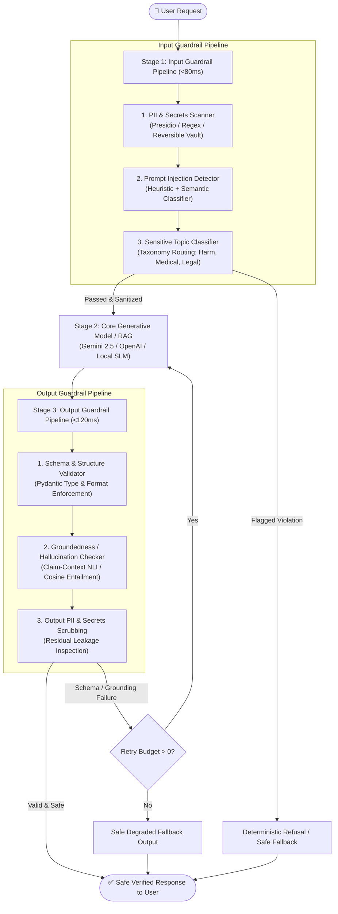

# fuseAiF_wk18_trustworthy_ai_guardrails

<!-- sync-status:start -->
**Last synchronized:** 2026-10-18
<!-- sync-status:end -->

[](https://www.python.org/downloads/)
[](https://github.com/astral-sh/ruff)
[](https://docs.pytest.org/)
[](LICENSE)

> **Fuse AI Fellowship 2026 — Week 18: Trustworthy AI**
> Production-grade Input and Output Guardrails Architecture for generative AI applications. Implements multi-stage pre-execution security (PII redaction, prompt injection defense, sensitive topic classification) and post-execution reliability (Pydantic schema validation, claim-level groundedness verification, sensitive leakage suppression) with a fail-closed circuit breaker.

---

## 🎯 Project Overview & Core Requirements

As modern generative AI models and autonomous agent workflows are deployed into high-stakes customer-facing environments, guardrail systems provide an essential layer of defensive abstraction. This repository fulfills the **Fuse AI Fellowship Week 18 Assignment**:

1. **Input Guardrails Pipeline**:
   - **PII Detection & Redaction**: Multi-pattern identification (Email, Phone, SSN/ID, API keys) with reversible `TokenizationVault`.
   - **Prompt Injection Detection**: Hybrid heuristic and semantic classification defending against roleplay jailbreaks, delimiter hijacking, and direct instruction overrides.
   - **Sensitive Topic Classification**: Policy-driven taxonomy triage (Self-Harm, Hate Speech, Malicious Exploits, Legal/Medical Advice) with deterministic early refusal.

2. **Output Guardrails Pipeline**:
   - **Schema Validation**: Strict Pydantic model validation guaranteeing response structure, required field constraints, and types.
   - **Groundedness & Hallucination Verification**: Claim extraction with NLI entailment scoring against source context documents.
   - **Sensitive Information Scrubbing**: Secondary verification preventing residual model disclosure of private data.

3. **Evaluation Suite & Diagnostics**:
   - **25+ Golden Test Benchmark** across 5 distinct failure surfaces.
   - Empirical metric reporting: Precision, Recall, F1-Score, False Positive Rate (FPR), and False Negative Rate (FNR).
   - In-depth failure mode analysis, safety-usability trade-off evaluation, and deployment risk assessment.

---

## 🏗️ Architecture



---

## 📁 Repository Layout

```
fuseAiF_wk18_trustworthy_ai_guardrails/
├── assignment/
│   └── Trustworthy AI _ Assignment-1.pdf                          # Primary assignment PDF
├── docs/
│   ├── REPORT.md                                                  # Comprehensive Evaluation & Trade-off Report
│   ├── Open Questions.pdf                                         # Discussion prompts
│   ├── Open Questions.md                                          # Discussion markdown
│   ├── Roadmap-Responsible_and_Trustworthy_AI_Learning_Resources.pdf
│   └── Roadmap-Responsible_and_Trustworthy_AI_Learning_Resources.md
├── guardrails/
│   ├── input/
│   │   ├── __init__.py
│   │   ├── pii_detector.py                                        # PII detection & reversible tokenization
│   │   ├── injection_detector.py                                  # Prompt injection & jailbreak defense
│   │   └── sensitive_topic_classifier.py                          # Policy & high-risk topic triage
│   ├── output/
│   │   ├── __init__.py
│   │   ├── schema_validator.py                                    # Pydantic v2 output format gate
│   │   ├── groundedness_checker.py                                # Context entailment & hallucination check
│   │   └── leak_scrubber.py                                       # Output data leakage scrubbing
│   ├── models.py                                                  # Common data structures & verdicts
│   └── pipeline.py                                                # End-to-end unified orchestrator
├── eval/
│   ├── golden_benchmark.jsonl                                     # 25+ curated benchmark test cases
│   └── run_eval.py                                                # Automated metric & matrix evaluation engine
├── tests/
│   ├── test_input_guardrails.py                                   # Pytest unit tests for input controls
│   ├── test_output_guardrails.py                                  # Pytest unit tests for output controls
│   └── test_pipeline_integration.py                               # Full system end-to-end integration tests
├── ui/
│   └── streamlit_app.py                                           # Interactive Guardrails Test Console
├── pyproject.toml                                                 # uv & dependency definitions
├── ruff.toml                                                      # Linter configuration
├── pytest.ini                                                     # Test runner configuration
├── sync.ps1                                                       # Automated ecosystem sync script
├── sync.bat                                                       # Windows zero-friction bypass wrapper
├── AGENTS.md                                                      # Agent rules and verification invariants
└── README.md
```

---

## ⚡ Quickstart

### 1. Environment Setup
```powershell
# Using uv (recommended)
uv venv
.venv\Scripts\activate
uv pip install -e .

# Or standard pip
python -m venv .venv
.venv\Scripts\activate
pip install -r pyproject.toml
```

### 2. Run Verification Gates
```powershell
# Lint check
ruff check .

# Unit and integration test suite
pytest tests/ -v
```

### 3. Run Benchmark Evaluation
```powershell
python eval/run_eval.py
```

### 4. Launch Interactive Web Console
```powershell
streamlit run ui/streamlit_app.py
```

---

## 🔄 Version Control & Sync

To maintain consistency and enforce pre-commit verification gates, version control runs through `sync.bat`:

```powershell
.\sync.bat                              # Automated pre-commit lint, test, pull, and push
.\sync.bat -m "feat(scope): summary"     # Custom conventional commit
.\sync.bat -WhatIf                      # Dry-run preview
.\sync.bat -PullOnly                    # Safe pull
```
